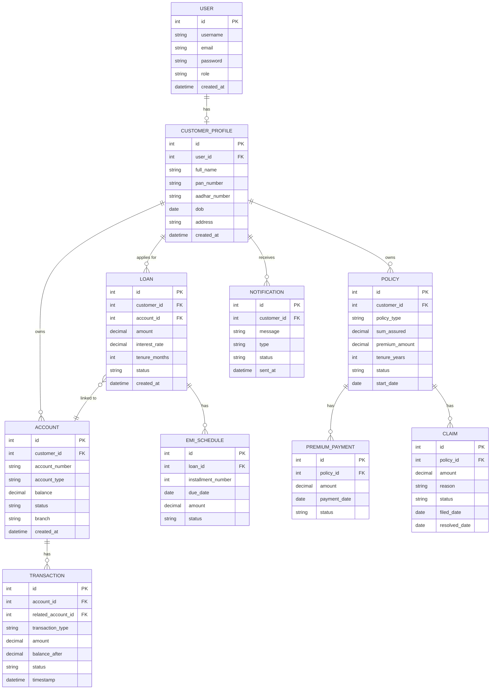

# Entity Relationship Diagram (ERD)
## Project: FinCore — Integrated Banking & Insurance Backend System

**Version:** 1.0
**Related Documents:** [BRD.md](./BRD.md), [SRS.md](./SRS.md)

---

## 1. Diagram (Mermaid format — renders directly on GitHub)

---

## 2. Entity Descriptions (Simple English)

### USER
The base login account. Every person (customer, bank employee, insurance agent, admin) has one User record with a role field that decides what they can access.

### CUSTOMER_PROFILE
Extra details for users with role = "customer" — like their KYC info (PAN, Aadhar, address). Linked one-to-one with USER.

### ACCOUNT
A bank account belonging to a customer. One customer can have many accounts (savings, current, etc.).

### TRANSACTION
Every deposit, withdrawal, or transfer creates one transaction record. For a transfer, `related_account_id` stores the other account involved, so we can trace money movement both ways.

### LOAN
A loan applied for by a customer, linked to one of their accounts (where the loan amount gets credited and EMIs get deducted from).

### EMI_SCHEDULE
Each loan is broken into monthly installments. One loan has many EMI_SCHEDULE records (installment 1, 2, 3...).

### POLICY
An insurance policy (life/health/vehicle) owned by a customer.

### PREMIUM_PAYMENT
Every time a customer pays a premium for their policy, one record is created here. One policy can have many payments over its lifetime.

### CLAIM
A claim filed by a customer against their policy. One policy can have multiple claims over time.

### NOTIFICATION
A log of every email/SMS sent to a customer (transaction alerts, premium reminders, claim updates).

---

## 3. Relationship Summary

| Relationship | Type |
|---|---|
| User → Customer Profile | One-to-One |
| Customer Profile → Account | One-to-Many |
| Account → Transaction | One-to-Many |
| Loan → EMI Schedule | One-to-Many |
| Customer Profile → Loan | One-to-Many |
| Customer Profile → Policy | One-to-Many |
| Policy → Premium Payment | One-to-Many |
| Policy → Claim | One-to-Many |
| Customer Profile → Notification | One-to-Many |

---

## 4. Notes for Implementation

- `role` field on USER will use choices: `customer`, `bank_employee`, `insurance_agent`, `admin`
- `account_type` choices: `savings`, `current`
- `transaction_type` choices: `deposit`, `withdrawal`, `transfer_in`, `transfer_out`
- `status` fields (account/loan/policy/claim) will each have their own choice list, defined when building that specific model
- All money fields (`balance`, `amount`, `premium_amount`, `sum_assured`) will use Django's `DecimalField`, never `FloatField` — this avoids rounding errors in financial calculations

---

## 5. Next Document

The **API Design Document** will map each of these entities to actual REST API endpoints (URL, method, request, response) for every functional requirement listed in SRS.md.
